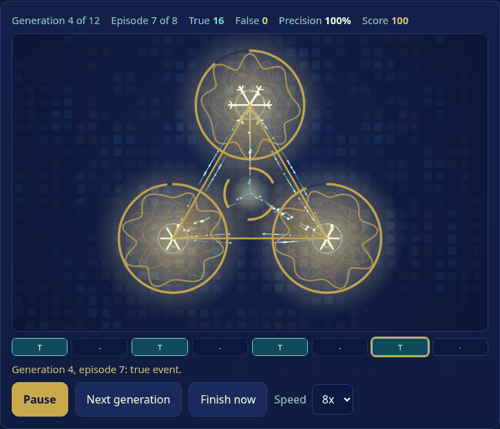
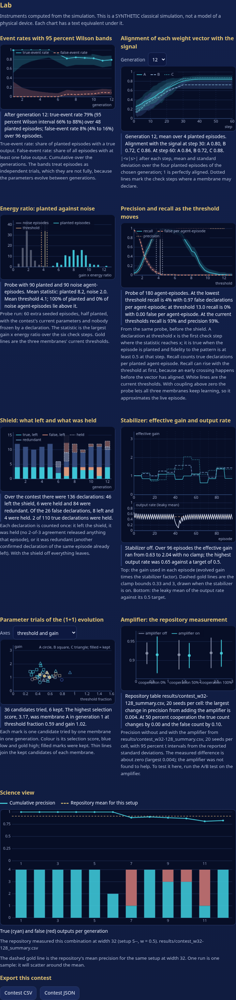

# Membrane Arena

**Steer three coupled membranes toward true crystallization events.** A SYNTHETIC, classical simulation turned into a game and a small lab: three glowing membranes ripple on a canvas, particles flow between them, a true event grows a branching gold crystal and a false one leaves grey cracks, and a Lab view plots every instrument from the simulation with its uncertainty. Zero dependencies, one HTML file, English and French, works offline. No accounts, no network calls.

Résumé FR : jeu éducatif SYNTHÉTIQUE (simulation classique) construit sur le dépôt crystallization-contest. Trois membranes couplées apprennent un motif planté dans le bruit par la règle d'Oja ; vous choisissez le schéma de récompense, la coopération, le bouclier 2 sur 3, l'amplificateur et le stabilisateur, puis comparez votre score aux mesures du dépôt, avec la source citée. Concours quotidien identique pour tous, carte de partage en texte brut, liens de défi. Interface EN/FR.





Play it: https://sparkainlp-x.github.io/membrane-arena/ (GitHub Pages, built from `main` by CI). Status: version 0.3.5 (adds an experimental per-setting Wave Pulse region calibration; its fresh test is mixed and does not establish 90% coverage in every setting; the v0.3.4 locator engine and numeric results remain unchanged; 0.3.3 brought Pair Watch and its calibrated coach, 0.3.2 Reverse Pair and its held-out evaluation, 0.3.1 Reverse Membranes, 0.3.0 the brain architecture page and the Quorum Keeper logic game, 0.2.0 the Lab, ensembles, A/B tests, missions, replay and high-contrast mode). Seven pages, all linked to each other: [the arena](https://sparkainlp-x.github.io/membrane-arena/), [brain architecture](https://sparkainlp-x.github.io/membrane-arena/brain.html), [Quorum Keeper](https://sparkainlp-x.github.io/membrane-arena/quorum.html), [Reverse Membranes](https://sparkainlp-x.github.io/membrane-arena/reverse.html), [Reverse Pair](https://sparkainlp-x.github.io/membrane-arena/pair.html), [Pair Watch](https://sparkainlp-x.github.io/membrane-arena/watch.html) and [Wave Pulse](https://sparkainlp-x.github.io/membrane-arena/pulse.html). The latest release is listed on the [releases page](https://github.com/sparkainlp-x/membrane-arena/releases); 0.3.5 is archived on Zenodo with DOI [10.5281/zenodo.23680525](https://doi.org/10.5281/zenodo.23680525). Earlier versions on Zenodo: 0.3.4 [10.5281/zenodo.23647863](https://doi.org/10.5281/zenodo.23647863), 0.3.3 [10.5281/zenodo.23645840](https://doi.org/10.5281/zenodo.23645840), 0.3.2 [10.5281/zenodo.23644414](https://doi.org/10.5281/zenodo.23644414), 0.3.1 [10.5281/zenodo.23642469](https://doi.org/10.5281/zenodo.23642469), 0.3.0 [10.5281/zenodo.23639631](https://doi.org/10.5281/zenodo.23639631), 0.2.0 [10.5281/zenodo.23633127](https://doi.org/10.5281/zenodo.23633127) (concept DOI for all versions: [10.5281/zenodo.23633126](https://doi.org/10.5281/zenodo.23633126)).

## What you do

Play the arena: https://sparkainlp-x.github.io/membrane-arena/

Each contest is 12 generations of 8 episodes. In a planted episode the three membranes see noisy copies of one hidden pattern; in a noise episode they see random vectors. They cannot tell which. Each membrane tracks the strongest direction with Oja's rule and declares an event when its gain-scaled energy ratio crosses a threshold. A declaration is **true** when the episode is planted and the vector matches the pattern, otherwise **false**.

You choose, and may change between generations:

- a **reward scheme** (individual, team, difference, consensus, or none);
- **competition versus cooperation** (the repository's `w`);
- the **shield** (an event leaves only if 2 of 3 membranes agree);
- the **amplifier** (warm start from the last output, capped at 0.5);
- the **stabilizer** (leaky integrator on the output rate, gain clamped to 0.33 to 3);
- **(1+1) evolution** of each membrane's threshold, coupling and gain (switch it off to freeze the parameters);
- starting parameters (before the run), and a cost per false event.

Starting parameters are set by the seed, so the daily contest begins in the same place for everyone. "Use the repository start" restores the values every baseline in the repository started from (threshold 0.5, coupling 0.05, gain 1.0).

When the contest ends you see your score, a comparison with the repository's measured means (file cited), a lesson card, the parameters each membrane started and ended with, and a plain-text share card.

Keys: Space run or pause, G next generation, F finish now, S open the Lab. Escape skips the intro.

## The Lab (new in 0.2.0)

Six tabs under the arena. Every plotted number is computed by the simulation in the page or read from a repository CSV copy, and every chart has a text equivalent printed under it.

| Tab | What it shows | Where the numbers come from |
| --- | --- | --- |
| Meters | the three gains, the output rate, the evolution fitness | the contest record |
| Lab | event rates with 95 percent Wilson bands; alignment of each weight vector with the signal; energy-ratio histogram of planted against noise with the three thresholds; precision and recall as the threshold moves; shield counts (left, held, redundant); stabilizer gain and rate trace with the clamp bounds; the (1+1) evolution landscape; the amplifier measurement from the repository | the contest record, plus a seeded probe run of extra episodes for the histogram and the sweep (`lab.js`) |
| Ensemble | N seeds (10 to 80) run a little at a time in the page, mean with a 95 percent t interval and a seeded bootstrap interval, the repository mean overlaid and its file named, a like-for-like note | `lab.js` `createEnsemble`; baselines from `baselines.js` |
| A/B test | two settings of one factor on the same seeds, paired difference with a t interval and a bootstrap interval, wins per seed | `lab.js` `createPaired`, `stats.js` |
| Missions | five small experiments tied to the repository's findings; each is scored by the same code, as measured, whether or not it matches the repository; progress is kept in this browser only | `lab.js` `evaluateMission` |
| Method | what was measured, what is the game's own design, what is not verified, and what each visual encodes | `i18n.js` |

Contest and ensemble results export as CSV or JSON, and the plain-text share card is unchanged. After a contest a **replay** slider scrubs the whole run (5760 steps) with a rail of every declaration; the arena redraws crystals, cracks, compass needles and the shield gate for the position you choose.

Accessibility modes: a **Motion** switch (in addition to the system setting) stops ripples, particles and the intro; **High contrast** draws white on black with heavier lines and no glow; the arena has a text description that follows the replay, and the tabs work with arrow keys, Home and End.

## Brain architecture (new in 0.3.0)

Live page: https://sparkainlp-x.github.io/membrane-arena/brain.html
`dist/brain.html` (or `node scripts/brain.js`) builds a layered "brain" from the arena's membranes: columns of sensory membranes, one gate per column, integrators, one output, and optional inhibitory (stabilizer) and memory (amplifier) membranes, joined by microtubules. Here a microtubule is a directed link with a delay, and the name is a metaphor only. You say how many faults each layer must tolerate. The page then works out the necessary number of each membrane (2f + 1 voters with a strict-majority quorum per layer), checks the wiring and timing, draws the diagram, and runs a seeded simulation with injected faults. The defaults give 15 membranes and 17 microtubules.

Measured in this simulation only (`docs/brain-check.txt`): within the fault bound there were no false outputs; past it, colluding faults decided every output. Tolerating faults costs recall (0.99 down to 0.41 at the bound). Coupling inside a column leaks faults through the vote. See [docs/BRAIN.md](docs/BRAIN.md).

## Quorum Keeper, a logic game on the brain architecture (new in 0.3.0)

Play it: https://sparkainlp-x.github.io/membrane-arena/quorum.html
`dist/quorum.html` is a puzzle game built on the brain page's voting rule. In 7 Build levels you size the brain (members per column, columns, integrators, inhibitory membrane) within a budget, and an adversary tries every placement of faults the level allows. In 7 Break levels you are the adversary: mark faulty units to fool or silence a given brain, or claim it cannot be done. Stars reward a brain that no placement breaks, a measured recall target, and par cost. Budgets, targets and pars come from a full search (`node scripts/quorum-check.js`, `docs/quorum-check.txt`). It is a game on a SYNTHETIC simulation; see [docs/QUORUM.md](docs/QUORUM.md).

## Reverse Membranes, the arena run backwards (new in 0.3.1)

Play it: https://sparkainlp-x.github.io/membrane-arena/reverse.html
`dist/reverse.html` reverses the arena. The hidden pattern is dark: one direction has had its energy removed from every observation. Reverse membranes use the arena's learning rule with the sign flipped (anti-Hebbian), so they slide away from energy and settle in the gap. They declare when their "opposite energy" (how far their energy falls below chance) crosses your threshold. Each contest starts with forward membranes, which find nothing here. You choose the polarity, the threshold, an echo that replays recent observations, and the shield, over 12 rounds whose darkness rises and falls. A mirror test shows that only the matching polarity finds each kind of pattern. The page runs at width 16, because a missing direction is learned too slowly at the arena's 32 (`node scripts/reverse-check.js`, `docs/reverse-check.txt`). "Opposite energy" is only a score's name: nothing on the page models negative energy, antimatter or any physical system. See [docs/REVERSE.md](docs/REVERSE.md).

## Reverse Pair, a two-membrane shield (new in 0.3.2)

Play it: https://sparkainlp-x.github.io/membrane-arena/pair.html

`dist/pair.html` pairs two membranes on one channel and one clock. The observer is a reverse membrane that hunts a dark pattern. The calibrator is predictable: it does not learn, plays known signed-amplitude sine tones (the Digital-to-Wave coding, 9 frequencies) and reads back how much of each arrives, so on a clean channel every reading is 1. In most episodes a fade dims part of the channel, and a fade also looks like missing energy. You set the tick (observer ticks per calibrator tick), the threshold, an equalizer that corrects observations with the calibrator's readings, a 2-membrane shield (the arena's 2-of-3 shield cut down to two), and whether fades sit on the calibrator's tones or between them.

It comes with a frozen evaluation protocol ([docs/PAIR-PROTOCOL.md](docs/PAIR-PROTOCOL.md)): thresholds chosen on 40 calibration seeds, results on 120 separate held-out seeds, paired comparisons with 95% bootstrap intervals and effect sizes, baselines and ablations including an oracle and a random baseline. On the held-out seeds, at 2 : 1, the full pair beats the observer alone by +41.11 points [39.80, 42.42] when fades sit on the calibrator's tones and by +27.78 [26.31, 29.25] when they sit between them: smaller off-grid, but not gone. Most of the gain comes from the equalizer. The shield's large score gain is almost all the arena's scoring rule: its vote does stop some false outputs (0.12 per contest on-grid, 1.02 off-grid), but it stops more true ones, and its net filtering effect on the score is not detectable (-0.07 [-0.17, 0.03] on-grid, -0.16 [-0.55, 0.22] off-grid). One command regenerates every number, with seeds, versions and SHA-256 hashes: `node scripts/pair-check.js --write` ([report](docs/pair-check.txt), [JSON](docs/pair-results.json), [CSV](docs/pair-results.csv), [manifest](docs/pair-manifest.json)); `--verify` recomputes and compares, and CI runs it on Node 20, 22 and 24. It is a game on a SYNTHETIC simulation: nothing on the page models oscillators, radio hardware, negative energy, antimatter or any physical system. See [docs/PAIR.md](docs/PAIR.md).

## Pair Watch, a visual game on the Reverse Pair
Play it: https://sparkainlp-x.github.io/membrane-arena/watch.html (locally, open `dist/watch.html`)
`dist/watch.html` turns Reverse Pair into a game you watch and judge. You are the second vote of the 2-membrane shield. Each wave is one Reverse Pair episode drawn tick by tick: the observer's dark core grows toward its threshold ring, the calibrator sends its sine tones down nine lanes and reads back how much arrives, and a rail shows whose turn each tick is. When the observer declares, you accept or veto the find, then the true channel is revealed. Three stages of 8 waves follow the Reverse Pair findings: the observer alone, then the equalizer unlocks, then off-grid fades. At the end your calls are compared with the calibrator's own shield vote, accepting everything, vetoing everything and perfect calls on the same waves. Every wave is an exact `pair.js` episode at the thresholds tuned on calibration seeds; the game changes no published result and its points are its own. English and French, phone, high contrast, keyboard, offline. See [docs/WATCH.md](docs/WATCH.md).

Turn on the **coach** for a second opinion: a logistic model that sees only what you see at a declaration and shows its estimate that the find is real, with a 95% interval, against the break-even point of 0.6 that follows from the points table. It was fitted once on 200 calibration runs and frozen (`watch-coach.js`); your own call is what scores. A finished run gives a **replay code** in the page address: opening the link replays every wave from the seed and shows the checked points, so a code can only show the score its calls really earn.

The coach has its own frozen protocol ([docs/WATCH-PROTOCOL.md](docs/WATCH-PROTOCOL.md)) and held-out evaluation on 200 separate runs ([docs/watch-check.txt](docs/watch-check.txt)). With the default settings, the coach is well calibrated (expected calibration error 0.0083 [0.0063, 0.0136]). Its calls earn 1084.8 [1055.0, 1113.5] points per run, against 1053.0 [1022.7, 1084.6] for the calibrator's shield and 914.4 [878.6, 951.2] for accepting every find. Paired by seed, the coach is ahead of the shield by +31.9 [+16.5, +47.6], a small effect (d_z 0.28; 138 of 200 runs tie). Perfect calls would still score 211.7 more per run.

## Wave Pulse, a ripple across the membrane grid

Play it: https://sparkainlp-x.github.io/membrane-arena/pulse.html (locally, open `dist/pulse.html`)

`dist/pulse.html` is page 7, a SYNTHETIC visual game on a small classical simulation. A big win or a crowd cheer sends a ripple across a 40 × 26 membrane grid. The floor is covered and you only see the recordings of 8 (or 4) sensors at its edge; you tap where you think the ripple started, then watch it replayed in a Great Wave colour style with the true start, your guess and the locator's answer. 12 pulses in 3 stages: big wins, crowd cheers with loud noise, and a patchy floor with a hidden slow patch and only 4 sensors. Free waves let you tap anywhere to send a ripple. It is not a model of a real arena floor, real pressure waves, holography or any physical system; the Great Wave look is a colour style only.

The locator (time difference of arrival, least squares) has its own frozen protocol ([docs/PULSE-PROTOCOL.md](docs/PULSE-PROTOCOL.md)) and held-out evaluation on 200 pulses in 16 settings ([docs/pulse-check.txt](docs/pulse-check.txt)). In the default setting it is off by 0.62 [0.57, 0.68] cells, against 3.05 [2.89, 3.21] for the early-sensor average and 9.34 [8.79, 9.89] for always guessing the centre. All six hypotheses in the protocol held, with paired intervals above zero (patchy floor +0.65 [+0.53, +0.78] cells, loud noise +0.90 [+0.69, +1.13], 4 sensors +0.13 [+0.07, +0.18], crowd cheers +0.33 [+0.27, +0.39]). A negative result: its 90% region is calibrated in only 2 of 16 settings (99.5% coverage on a calm, even floor; 59.0% with loud noise on a patchy floor). Details: [docs/PULSE.md](docs/PULSE.md).

The results above are the archived shared-region evaluation. The v0.3.5 experimental update uses setting-specific region sizes, but its fresh test still misses the 90% target in some settings; see the [v0.3.5 calibration report](docs/PULSE-REGION-v035.md).

## The score

`Score = 50 x net true events + 25 x precision + 25 x steadiness`, all on a 0 to 100 scale. Net true events count an unshielded output as one third of an episode (three membranes can each fire) and a shielded output as a whole episode, divided by the 48 planted episodes. Steadiness is one minus the variance of the per-generation output rate over 0.05, clamped. **These weights are this game's own. The repository has no game score.** Part of the shield's steadiness is mechanical: it allows at most one output per episode. The comparison table applies the same formula to the repository's mean counts, which is approximate and labelled so.

## What is real and what is not

Measured in the repository ([crystallization-contest](https://github.com/sparkainlp-x/crystallization-contest), v0.1.0, commit `c74c60b`, width 32, 20 seeds per row):

| Claim in the game | Source file | Value |
| --- | --- | --- |
| Shield cuts false events | `results/contest_w32-128_summary.csv`, `results/contest_256_summary.csv` | 2.3 to 3.2 times fewer (w = 0.5, widths 32 to 256) |
| Shield steadies the output rate | same | about 8 to 17 times lower rate variance |
| Amplifier does nothing | same | precision differs by at most 0.004 in any row |
| Stabilizer costs precision | same | 0.3 to 4.8 points (w = 0.5, SA- to SAZ) |
| Stabilizer stops runaway gain | `results/stress_summary.csv` | 20 to 35 percent of runs ran away without it, none with it |
| Individual reward was weakest | `results/sweep_summary.csv` | fewest true events in 10 of 15 cells |

These numbers are computed from the CSV copies in `data/` by `scripts/make-baselines.js` into `baselines.js`; a test checks the committed file matches a fresh generation, and another re-derives them independently.

Measured **in this port, not in the repository** (see `docs/`):

- `docs/port-check.txt`: the JavaScript port against the repository's 12 width-32 rows, 100 seeds each. 36 comparisons, none beyond 2 standard errors, largest 1.07.
- `docs/evolve-check.txt`: the (1+1) step helps from a poor start and can lose to keeping good hand-picked parameters.
- `docs/scheme-check.txt`: the reward-scheme bonus moved the mean game score by little (the five schemes' means lay within 1.4 points of each other, 40 seeds, significance not tested).

Not real: the data are synthetic, the parameters were hand-picked, the reward-scheme bonus is this game's own way to combine a scheme with the evolution step (the repository measured schemes on their own, and that combination was not measured), and the score weights are this game's. Nothing here measures a physical system.

## Mechanics to code

| Mechanic | Where |
| --- | --- |
| Oja's rule agents, coupling to the other two | `game.js` `episode()` |
| Energy-ratio declaration, checked every 10 steps | `game.js` `episode()`, `energyRatio`, `scaledThreshold` |
| Truth label (fidelity at least 0.5 to the pattern) | `game.js` `isTrueEvent` |
| Reward schemes | `game.js` `reward`, `systemEvent` |
| Cooperation versus competition | `game.js` `stepGeneration` (`w * joint + (1 - w) * rank bonus`) |
| Shield, 2 of 3, fail closed | `game.js` `stepGeneration` (`passed`) |
| Capped amplifier | `game.js` `warmStart` (cap 0.5) |
| Stabilizer | `game.js` `stabilizerFactor`, `leakyUpdate`, `clampGain` |
| (1+1) evolution | `game.js` `stepGeneration` (mutate, accept when the score does not fall) |
| Self-knowledge `sp`, effective threshold `th * (2 - sp)` | `game.js` `episode()`, `stepGeneration` |
| Seeded determinism | `game.js` `makeRng`, `createContest` |
| Baselines and lessons | `baselines.js` (generated), `game.js` `baselineFor`, `lessonVars` |
| Membranes, particles, crystals, cracks, compass dials, shield gate, intro, replay | `scene.js` `createArena`, `crystalSegments`, `snapshotAt` |
| Statistics: Wilson, Student t, bootstrap, paired difference | `stats.js` |
| Probe, sweep, ensembles, A/B pairs, missions, exports, text equivalents | `lab.js` |
| Instrument drawing | `charts.js` |
| Tabs, ensemble and A/B interface, missions interface | `labui.js` |
| Gain meters, controls, replay, tour, share card | `app.js`, `scene.js` `drawFitness`, `drawScience` |

## Privacy

No accounts, no trackers, no network calls (the tests scan the built page for network APIs and remote URLs). Your record stays in this browser (local storage, read defensively, ignored if unavailable or damaged). Because the game runs on the client, the daily result is computable from the source: scores are for learning, not a ranking.

## Run it

```bash
node build.js                 # writes dist/index.html (one self-contained file)
node scripts/serve.js 8080    # preview at http://127.0.0.1:8080/
node --test tests/*.test.js            # the test suite, no dependencies
node scripts/brain.js         # plan, check and run the brain architecture
node scripts/brain-check.js   # rewrite docs/brain-check.txt (about 2.5 minutes)
node scripts/quorum-check.js --write   # rewrite docs/quorum-check.txt, the game's level calibration (about 1 minute)
node scripts/reverse-check.js --write  # rewrite docs/reverse-check.txt, the Reverse Membranes measurements (about 80 seconds)
node scripts/pair-check.js --write     # regenerate every Reverse Pair number: report, JSON, CSV, manifest (about 90 seconds)
node scripts/pair-check.js --verify    # recompute and compare with the written files (exit 1 on any difference)
node scripts/watch-check.js --write    # fit the Pair Watch coach on calibration runs and evaluate it on held-out runs (about 20 seconds)
node scripts/watch-check.js --verify   # recompute and compare with the written files
node scripts/pulse-check.js --write    # calibrate the Wave Pulse locator and evaluate it on held-out pulses (about 6 seconds)
node scripts/pulse-check.js --verify   # recompute and compare with the written files
node scripts/port-check.js    # the port against the repository means (about 2 minutes)
```

Open `dist/index.html` directly in a browser, or serve it. Node 20 or later is only needed for the tests and the build.

## Tests

`node --test tests/*.test.js` runs 308 tests (v0.3.5) with Node's built-in runner and no dependencies. It covers: seeded determinism of the whole contest and of lazy stepping, the contest mechanics (shield, amplifier cap, stabilizer clamp and leaky update, evolution acceptance and bounds, reward schemes), scoring, baseline lookup, hash links and hostile input, the store sanitizer, dates and streaks, i18n parity and share-card line length in both languages, the timeline and layout helpers, the arena with a stub canvas, the statistics (Wilson and t interval coverage against known cases by simulation, bootstrap, the paired test's false-positive rate near 5 percent, histograms), the Lab data (probe, sweep, shield counts, ensembles reproducing the repository means, A/B pairing, missions, CSV and JSON), the instrument drawing at four sizes, text equivalents in both languages, a golden test that seeds `golden1` and `d2026-10-24` still give the exact v0.1.0 numbers (so v0.1 challenge links keep working), and the built page (self-contained, no network APIs, ids and keys exist, accessibility basics, brand colours, no banned wording). The brain architecture adds 19 tests: the counting rule over every fault placement, plan counts, a column reproducing `game.js` draw for draw, the shield rule, fusion, delays and the deadline, the wiring checker, determinism and hostile options, seeded fault runs, the stabilizer, the SVG, string parity and the brain page. Quorum Keeper adds 19 tests: the vote rule, the symbolic evaluator against the brain page logic on 2,000 random cases, the adversary against a brute force over every subset, the 2f + 1 rule in the game, every level's par design and intended answer, the calibration report, scoring, clamping, reproducibility, the SVG, the score card, string parity and the game page. Reverse Membranes adds 24 tests: dark samples, the reverse update removing each observation, opposite energy, frozen traces, reverse membranes finding dark patterns while forward ones never do, the shield, the seeded darkness tide and starting controls, a golden contest, echo, the mirror test, links, the score card, and the page (self-contained, ids and keys, the SYNTHETIC notice in both languages, and every number it quotes matching `docs/reverse-check.txt`). Reverse Pair adds 28 tests: the Fourier transform, the signed-amplitude tones, the calibrator's predicted reading error, on-grid and off-grid fades (off-grid centres, bandwidth, leakage, an orthonormal fade subspace), paired worlds shared by every method, the equalizer, the oracle's exact inverse, the tick schedule, the shield vote, decisions and the random baseline, episodes fooled by a fade without help, golden contests on-grid and off-grid, starting controls, hostile settings, the calibration check for both fade kinds, the score card, links, the five pages linking each other, and the page and docs (self-contained, ids and keys, the SYNTHETIC notice in both languages, every number the page and `docs/PAIR.md` quote matching `docs/pair-check.txt`, the tuned thresholds matching the calibration choice, and the manifest's seeds and SHA-256 hashes matching the files). Pair Watch adds 35 tests: seeded runs of 3 stages, the equalizer lock, every wave's frames matching `pair.js` tick by tick, the declaration rule, the faded share shown on screen giving the calibrator's vote, off-grid fades in stage 3, the points and streak table, call order, the end-of-run comparison, golden runs, ranks, links and the score card, and the page and docs (self-contained, ids and keys, the SYNTHETIC notice in both languages, the rules on the page and in `docs/WATCH.md` matching the code), and in `tests/watchpro.test.js` the fast evaluator matching the played waves, the break-even point, the frozen coach (calibration seeds only, consistent shapes, lower trust in more faded finds), the policies, replay codes and every way they are rejected, the manifest's seeds and SHA-256 hashes, and the page and `docs/WATCH.md` quoting `docs/watch-check.txt`. Wave Pulse adds tests for the wave grid (quiet before the trigger, nearer sensors first, symmetry, the slow patch), the detector on noise alone, the locator on exact arrivals and its fallback, the baselines, points, stages, golden runs, replay codes and links, the page in both languages, the seven-page links, and every number the page and `docs/PULSE.md` quote matching `docs/pulse-check.txt`.

`scripts/e2e-check.js` plays a full round in headless Chrome (English and French, phone and desktop, reduced motion, high contrast), opens every Lab tab, runs a 20-seed ensemble and a 20-pair A/B test, scrubs and plays the replay, exports CSV and JSON, checks that every instrument canvas is drawn and described, and records console errors, external requests, horizontal overflow, frame times, draw time per frame and ensemble run time. A second part runs 36 checks of storage, hash, keyboard, tabs, tour, intro and switches. It needs playwright-core and Chrome, so it is not part of `node --test`. The last run's report is `docs/e2e-report.json` and screenshots are in `docs/screenshots/`. `scripts/watch-e2e-check.js` plays whole Pair Watch runs by clicking and by keyboard (English and French, phone and desktop, high contrast, reduced motion), replays the same calls in Node and checks the page's points, every wave and the end table, the coach's estimates and the replay link, including the rejection of a mistyped code (`docs/watch-e2e-report.json`, `docs/screenshots/watch-*.png`). `scripts/pulse-e2e-check.js` plays whole Wave Pulse runs by clicking and by keyboard (English and French, phone and desktop, high contrast, reduced motion), free waves and replay links, and checks every pulse's arrival ticks and points against a Node replay (`docs/pulse-e2e-report.json`, `docs/screenshots/pulse-*.png`).

## Limits

- SYNTHETIC classical simulation at width 32 only; the repository measured other widths and the game does not show them.
- The port is statistically comparable to the Python original, not bit-identical (different random generators).
- Hand-picked parameters, 8 noisy episodes per generation, 20 seeds per repository row.
- The repository baseline rows exist only for the shield, amplifier and stabilizer combinations `---`, `S--`, `SA-`, `SAZ` and for w of 0, 0.5 and 1. Other combinations show "not measured".
- No screen-reader session was run; keyboard operation, `aria-live` announcements, `role="meter"` gauges and reduced-motion handling were implemented and checked in a browser, not with assistive technology.
- Frame times were measured in software-rendered headless Chrome on one machine, not on phones. Ensemble and A/B run times are from the same machine; a phone will be slower.
- The probe behind the energy-ratio histogram and the precision and recall sweep lets all three membranes keep learning after a threshold crossing, so with coupling above zero it approximates the live episode. It uses 24 episodes while a contest runs and 60 after it ends, so the live histogram is noisier.
- Ensemble and A/B comparisons with the repository table are like for like only with the repository setup (scheme none, no failure cost, evolution on, repository starting parameters); the page says when they are not.
- The A/B test is exploratory: four metrics are reported with no correction for that, and episodes inside one contest are not independent trials.
- Only Chrome was tested, with no screen reader.

See [DESIGN.md](DESIGN.md) and [CHANGELOG.md](CHANGELOG.md).

## Credit and references

Lineage: `game.js` is a port of crystallization-contest, whose helper functions come from membrane-crystallization, which began as a package received under Mun Seok Lee's name. The game design, interface, scoring and lesson text are this project's own. Mun Seok Lee is acknowledged for that earlier package only: he is not an author of this release and has not reviewed or endorsed it.

- Brisson, J.-F. Membrane Arena v0.3.5. https://doi.org/10.5281/zenodo.23680525
- Brisson, J.-F. Membrane Arena v0.3.4. https://doi.org/10.5281/zenodo.23647863
- Brisson, J.-F. Membrane Arena v0.3.3. https://doi.org/10.5281/zenodo.23645840
- Brisson, J.-F. Membrane Arena v0.3.2. https://doi.org/10.5281/zenodo.23644414
- Brisson, J.-F. Membrane Arena v0.3.1. https://doi.org/10.5281/zenodo.23642469
- Brisson, J.-F. Membrane Arena v0.3.0. https://doi.org/10.5281/zenodo.23639631
- Brisson, J.-F. Membrane Arena v0.2.0. https://doi.org/10.5281/zenodo.23633127
- Oja, E. (1982). Simplified neuron model as a principal component analyzer. *Journal of Mathematical Biology* 15(3), 267-273. https://doi.org/10.1007/BF00275687
- Brisson, J.-F. crystallization-contest v0.1.0. https://doi.org/10.5281/zenodo.23619515
- Brisson, J.-F. membrane-crystallization v0.1.0. https://doi.org/10.5281/zenodo.23583050

## License

Copyright (c) 2026 Jean-François Brisson, Spark AI NLP.

Available under the GNU Affero General Public License v3.0 only (AGPL-3.0-only); see [LICENSE](LICENSE).
