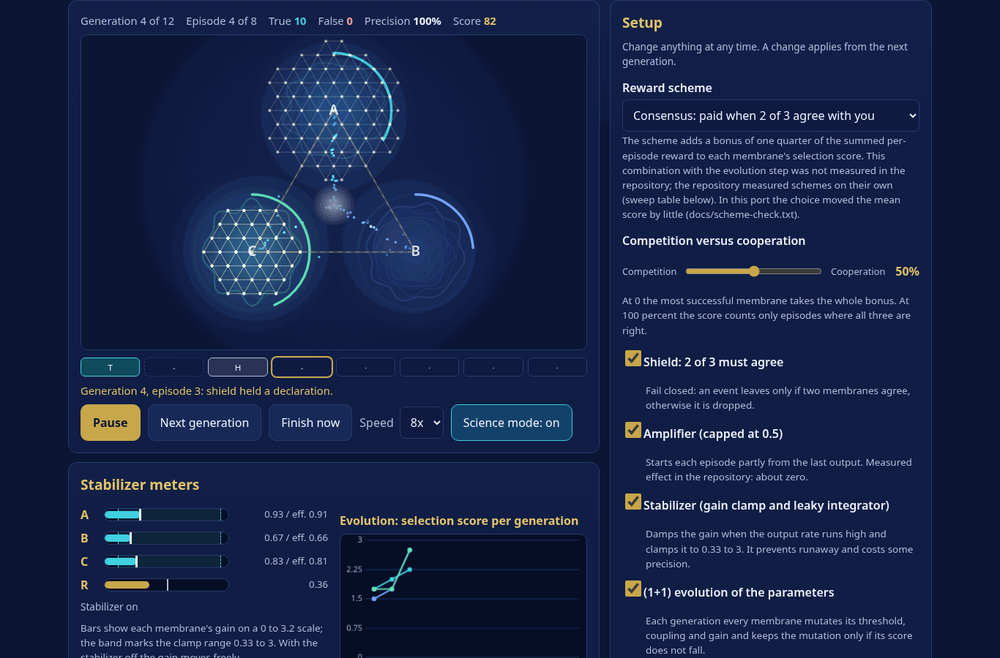

# Membrane Arena

**Steer three coupled membranes toward true crystallization events.** A SYNTHETIC, classical simulation turned into a game: three glowing membranes ripple on a canvas, particles flow between them, a true event bursts into a gold lattice and a false one into grey cracks. Zero dependencies, one HTML file, English and French, works offline. No accounts, no network calls.

Résumé FR : jeu éducatif SYNTHÉTIQUE (simulation classique) construit sur le dépôt crystallization-contest. Trois membranes couplées apprennent un motif planté dans le bruit par la règle d'Oja ; vous choisissez le schéma de récompense, la coopération, le bouclier 2 sur 3, l'amplificateur et le stabilisateur, puis comparez votre score aux mesures du dépôt, avec la source citée. Concours quotidien identique pour tous, carte de partage en texte brut, liens de défi. Interface EN/FR.



Play it: https://sparkainlp-x.github.io/membrane-arena/ (GitHub Pages, built from `main` by CI). Status: version 0.1.0. The tagged release and its DOI are not issued yet; this line is updated when they are.

## What you do

Each contest is 12 generations of 8 episodes. In a planted episode the three membranes see noisy copies of one hidden pattern; in a noise episode they see random vectors. They cannot tell which. Each membrane tracks the strongest direction with Oja's rule and declares an event when its gain-scaled energy ratio crosses a threshold. A declaration is **true** when the episode is planted and the vector matches the pattern, otherwise **false**.

You choose, and may change between generations:

- a **reward scheme** (individual, team, difference, consensus, or none);
- **competition versus cooperation** (the repository's `w`);
- the **shield** (an event leaves only if 2 of 3 membranes agree);
- the **amplifier** (warm start from the last output, capped at 0.5);
- the **stabilizer** (leaky integrator on the output rate, gain clamped to 0.33 to 3);
- **(1+1) evolution** of each membrane's threshold, coupling and gain (switch it off to freeze the parameters);
- starting parameters (before the run), and a cost per false event.

Starting parameters are set by the seed, so the daily contest begins in the same place for everyone. "Use the repository start" restores the values every baseline in the repository started from (threshold 0.5, coupling 0.05, gain 1.0).

When the contest ends you see your score, a comparison with the repository's measured means (file cited), a lesson card, the parameters each membrane started and ended with, and a plain-text share card.

Keys: Space run or pause, G next generation, F finish now, S science view.

## The score

`Score = 50 x net true events + 25 x precision + 25 x steadiness`, all on a 0 to 100 scale. Net true events count an unshielded output as one third of an episode (three membranes can each fire) and a shielded output as a whole episode, divided by the 48 planted episodes. Steadiness is one minus the variance of the per-generation output rate over 0.05, clamped. **These weights are this game's own. The repository has no game score.** Part of the shield's steadiness is mechanical: it allows at most one output per episode. The comparison table applies the same formula to the repository's mean counts, which is approximate and labelled so.

## What is real and what is not

Measured in the repository ([crystallization-contest](https://github.com/sparkainlp-x/crystallization-contest), v0.1.0, commit `c74c60b`, width 32, 20 seeds per row):

| Claim in the game | Source file | Value |
| --- | --- | --- |
| Shield cuts false events | `results/contest_w32-128_summary.csv`, `results/contest_256_summary.csv` | 2.3 to 3.2 times fewer (w = 0.5, widths 32 to 256) |
| Shield steadies the output rate | same | about 8 to 17 times lower rate variance |
| Amplifier does nothing | same | precision differs by at most 0.004 in any row |
| Stabilizer costs precision | same | 0.3 to 4.8 points (w = 0.5, SA- to SAZ) |
| Stabilizer stops runaway gain | `results/stress_summary.csv` | 20 to 35 percent of runs ran away without it, none with it |
| Individual reward was weakest | `results/sweep_summary.csv` | fewest true events in 10 of 15 cells |

These numbers are computed from the CSV copies in `data/` by `scripts/make-baselines.js` into `baselines.js`; a test checks the committed file matches a fresh generation, and another re-derives them independently.

Measured **in this port, not in the repository** (see `docs/`):

- `docs/port-check.txt`: the JavaScript port against the repository's 12 width-32 rows, 100 seeds each. 36 comparisons, none beyond 2 standard errors, largest 1.07.
- `docs/evolve-check.txt`: the (1+1) step helps from a poor start and can lose to keeping good hand-picked parameters.
- `docs/scheme-check.txt`: the reward-scheme bonus moved the mean game score by little (the five schemes' means lay within 1.4 points of each other, 40 seeds, significance not tested).

Not real: the data are synthetic, the parameters were hand-picked, the reward-scheme bonus is this game's own way to combine a scheme with the evolution step (the repository measured schemes on their own, and that combination was not measured), and the score weights are this game's. Nothing here measures a physical system.

## Mechanics to code

| Mechanic | Where |
| --- | --- |
| Oja's rule agents, coupling to the other two | `game.js` `episode()` |
| Energy-ratio declaration, checked every 10 steps | `game.js` `episode()`, `energyRatio`, `scaledThreshold` |
| Truth label (fidelity at least 0.5 to the pattern) | `game.js` `isTrueEvent` |
| Reward schemes | `game.js` `reward`, `systemEvent` |
| Cooperation versus competition | `game.js` `stepGeneration` (`w * joint + (1 - w) * rank bonus`) |
| Shield, 2 of 3, fail closed | `game.js` `stepGeneration` (`passed`) |
| Capped amplifier | `game.js` `warmStart` (cap 0.5) |
| Stabilizer | `game.js` `stabilizerFactor`, `leakyUpdate`, `clampGain` |
| (1+1) evolution | `game.js` `stepGeneration` (mutate, accept when the score does not fall) |
| Self-knowledge `sp`, effective threshold `th * (2 - sp)` | `game.js` `episode()`, `stepGeneration` |
| Seeded determinism | `game.js` `makeRng`, `createContest` |
| Baselines and lessons | `baselines.js` (generated), `game.js` `baselineFor`, `lessonVars` |
| Membranes, particles, lattice, cracks, shield flash | `scene.js` `createArena` |
| Gain meters, charts, controls, share card | `app.js`, `scene.js` `drawFitness`, `drawScience` |

## Privacy

No accounts, no trackers, no network calls (the tests scan the built page for network APIs and remote URLs). Your record stays in this browser (local storage, read defensively, ignored if unavailable or damaged). Because the game runs on the client, the daily result is computable from the source: scores are for learning, not a ranking.

## Run it

```bash
node build.js                 # writes dist/index.html (one self-contained file)
node scripts/serve.js 8080    # preview at http://127.0.0.1:8080/
node --test tests/*.test.js            # the test suite, no dependencies
node scripts/port-check.js    # the port against the repository means (about 2 minutes)
```

Open `dist/index.html` directly in a browser, or serve it. Node 20 or later is only needed for the tests and the build.

## Tests

`node --test tests/*.test.js` runs 88 tests with Node's built-in runner and no dependencies. It covers: seeded determinism of the whole contest and of lazy stepping, the contest mechanics (shield, amplifier cap, stabilizer clamp and leaky update, evolution acceptance and bounds, reward schemes), scoring, baseline lookup, hash links and hostile input, the store sanitizer, dates and streaks, i18n parity and share-card line length in both languages, the timeline and layout helpers, the arena with a stub canvas, and the built page (self-contained, no network APIs, ids and keys exist, accessibility basics, brand colours, no banned wording).

`scripts/e2e-check.js` plays a full round in headless Chrome (English and French, phone and desktop, plus reduced motion) and records console errors, external requests and frame times. It needs playwright-core and Chrome, so it is not part of `node --test`. The last run's report is `docs/e2e-report.json` and screenshots are in `docs/screenshots/`.

## Limits

- SYNTHETIC classical simulation at width 32 only; the repository measured other widths and the game does not show them.
- The port is statistically comparable to the Python original, not bit-identical (different random generators).
- Hand-picked parameters, 8 noisy episodes per generation, 20 seeds per repository row.
- The repository baseline rows exist only for the shield, amplifier and stabilizer combinations `---`, `S--`, `SA-`, `SAZ` and for w of 0, 0.5 and 1. Other combinations show "not measured".
- No screen-reader session was run; keyboard operation, `aria-live` announcements, `role="meter"` gauges and reduced-motion handling were implemented and checked in a browser, not with assistive technology.
- Frame times were measured in software-rendered headless Chrome on one machine, not on phones.

See [DESIGN.md](DESIGN.md) and [CHANGELOG.md](CHANGELOG.md).

## Credit and references

Lineage: `game.js` is a port of crystallization-contest, whose helper functions come from membrane-crystallization, which began as a package received under Mun Seok Lee's name. The game design, interface, scoring and lesson text are this project's own. Mun Seok Lee is acknowledged for that earlier package only: he is not an author of this release and has not reviewed or endorsed it.

- Oja, E. (1982). Simplified neuron model as a principal component analyzer. *Journal of Mathematical Biology* 15(3), 267-273. https://doi.org/10.1007/BF00275687
- Brisson, J.-F. crystallization-contest v0.1.0. https://doi.org/10.5281/zenodo.23619515
- Brisson, J.-F. membrane-crystallization v0.1.0. https://doi.org/10.5281/zenodo.23583050

## License

Copyright (c) 2026 Jean-François Brisson, Spark AI NLP.

Available under the GNU Affero General Public License v3.0 only (AGPL-3.0-only); see [LICENSE](LICENSE).
